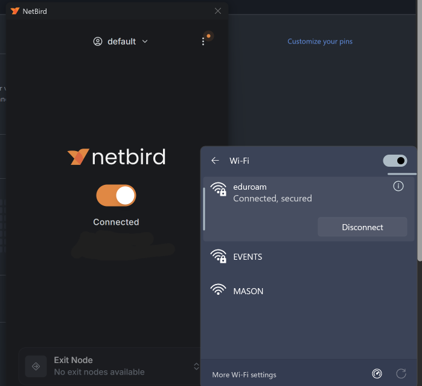
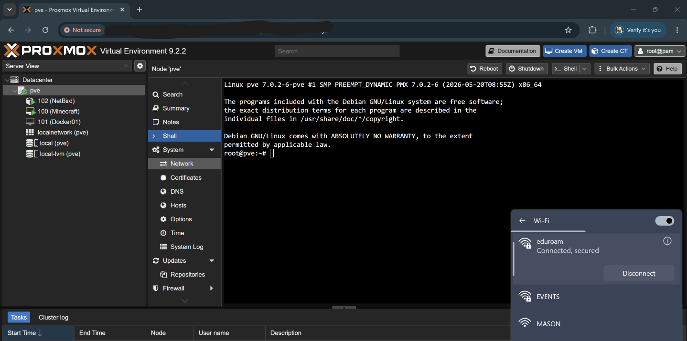

Screenshots Folder
------------------

THe netbird-screenshots folder is used to provide demonstration of using the NetBird VPN to access the Proxmox host server externally. 

Context
-------
1. Image 1 below is to demonstrate that activating the NetBird on a external network outside the network of the Proxmox host server is working as intended.
   
 

2. Image 2 below is to demonstrate successfully accessing the Proxmox host server remotely on an external network outside from the local network.

