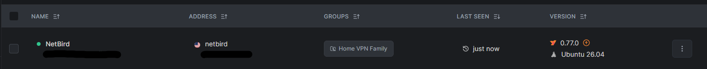

Updating NetBird
================

This short document showcases the process of updating NetBird in the Proxmox LXC container.
-------------------------------------------------------------------------------------------

1. Image 1 below showcases the previous version of NetBird at version 0.77.0

3. Image 2 below showcases the newer updated version of NetBird at version 0.82.0

Process of Updating NetBird
----------------------------------

Commands Used:

| Commands | Summary |
| -------- | ------- |
| apt update | Refreshes the package list of all available software packages |
| apt upgrade netbird | Upgrades NetBird package to a newer version |
| netbird version | Verifying NetBird package update was successful | 
| systemctl status NetBird | Verifying if NetBird service is running after the update | 
