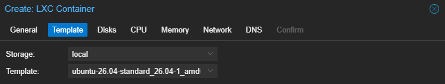
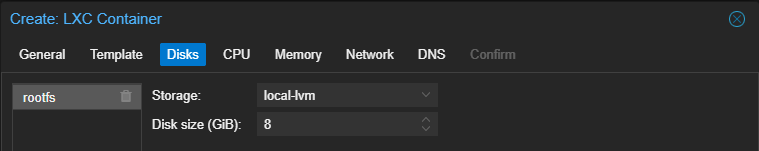
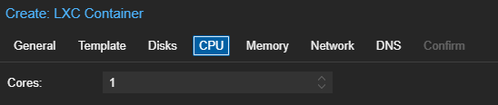
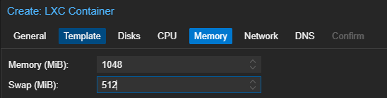
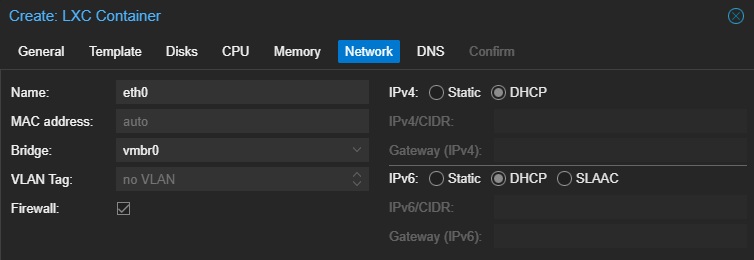

Creating LXC Container in Proxmox VE
====================================

The purpose of this markdown file is to document the process of creating an LXC container within the Proxmox VE environment.

For this demonstration, a test LXC container named "test" is created to document the process of deploying the NetBird VPN within the Proxmox Host.

Creating LXC Container
----------------------

1. Logged into Proxmox VE web interface
2. Selected Proxmox data center node: (pve)
3. Clicked on "Create CT" in the interface
4. Configured container settings

Table of Contents (Steps)
-------------------------
- Step 1: OS System Templete
- Step 2: Disk Allocation
- Step 3: CPU Configuration
- Step 4: Memory Configuration
- Step 5: Network Configuration

Step 1: OS System Templete
--------------------------
| Setting | Configuration |
| ------- | ------------- | 
| Template Storage | local |  
| Operating System | Ubuntu | 
| OS Version | 26.04 | 
| File Name | ubuntu-26.04-standard_26.04-1_amd64.tar.zst |

Ubuntu OS is located in the local storage of the pve.

Template Screenshot:

Step 2: Disk Allocation
-----------------------
| Setting | Configuration |
| ------- | ------------- | 
| Storage | local-lvm |
| Disk Size (GiB) | 8 | 

Disk Configuration Screenshot:

Step 3: CPU Configuration
-------------------------
| Setting | Configuration |
| ------- | ------------- | 
| Cores | 1 | 

Only 1 Core was allocated as the LXC container is only used for VPN purposes. NetBird VPN is a lightweight service and only less than 10 peers at once is planned.

CPU Configuration Screenshot: 

Step 4: Memory Configuration
----------------------------

| Setting | Configuration |
| ------- | ------------- | 
| Memory (MiB) | 1048 |
| Swap (MiB) | 512 |

Since only less than 10 peers at once is planned, 1048 MiB or 1 GiB is sufficient enough. As for the swap memory, the default 512 MiB is also just enough to prevent the container from crashing. 

Memory Configuration Screenshot: 

Step 5: Network Configuration
-----------------------------
| Setting | Configuration | Summary |
| ------- | ------------- | ------- |
| Name | eth0 | Network interface for the container |
| MAC Address | Auto | Automatically create a MAC address | 
| Bridge | vmbr0 | Connecting Promox network bridge to container |
| VLAN Tag | NO VLAN | VLAN is not configured | 
| Firewall | Enabled |  Filtering incoming and outgoing packets | 
| IPv4 | DCHP | Automatically request an IPv4 address from DHCP server |
| IPv4/CIDR | NONE | Static IPv4 is turned off |
| Gateway (IPv4) | NONE | Gateway information is gained through DHCP | 
| IPv6 | DHCP | Automatically request an IPv6 address through DHCPv6 |
| IPv6/CIDR | NONE | Static IPv6 is turned off
| Gateway (IPv6) | NONE | No manually configured IPv6 gateway | 

The LXC container is configured to use the vmbr0 bridge to communicate with the local network. IPv4 and IPv6 are configured to DHCP to allow network settings to be configured automaticaly. 

Network Configuration Screenshot: 

Summary
-------
The LXC container was made through the Proxmox VE web interface to configure the OS, storage, CPU, memory, and network settings. The newly created LXC will be used to document the installation of NetBird. 

For further details on the NetBird installation: [placeholder]

